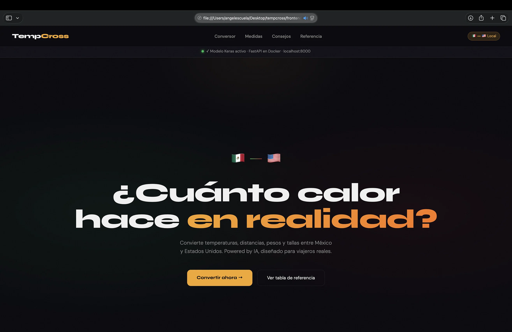
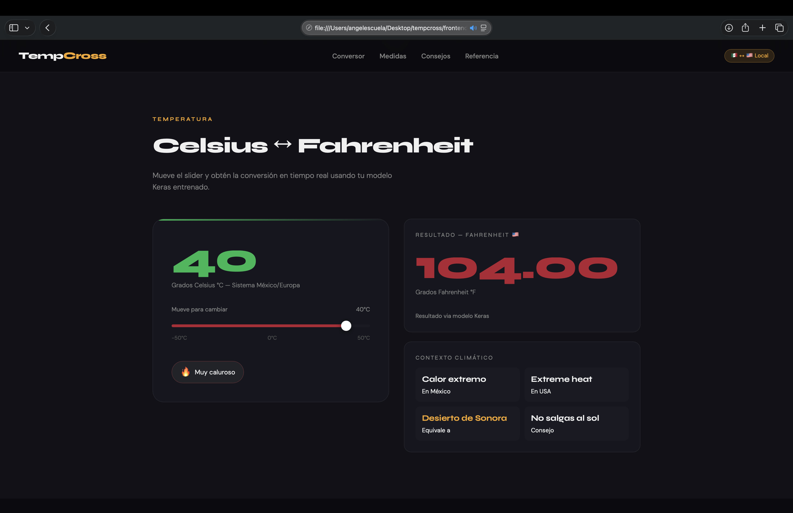
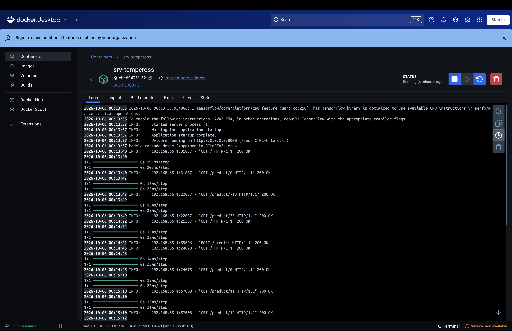
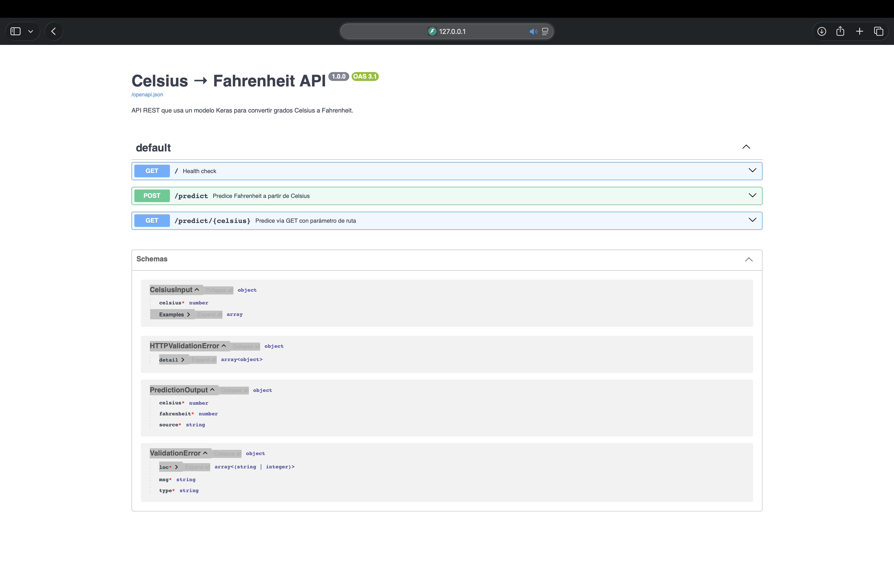

# TempCross - Conversor Celsius a Fahrenheit con IA

[](https://www.python.org/)
[](https://www.tensorflow.org/)
[](https://fastapi.tiangolo.com/)
[](https://www.docker.com/)
[](https://opensource.org/licenses/MIT)

Aplicación full-stack que convierte temperaturas entre Celsius y Fahrenheit usando un modelo de red neuronal entrenado con Keras, servido desde una API FastAPI en Docker, con interfaz web interactiva.

Incluye un mecanismo de fallback: si la API no está disponible, el frontend calcula la conversión con la fórmula tradicional, garantizando que la aplicación sea siempre usable.

---

## Tabla de contenidos

- [Contexto](#contexto)
- [Qué resuelve](#qué-resuelve)
- [Capturas](#capturas)
- [Arquitectura](#arquitectura)
- [Stack tecnológico](#stack-tecnológico)
- [Estructura del proyecto](#estructura-del-proyecto)
- [Instalación y uso](#instalación-y-uso)
- [Endpoints de la API](#endpoints-de-la-api)
- [Problemas resueltos](#problemas-resueltos)
- [Mi rol](#mi-rol)
- [Documentación adicional](#documentación-adicional)
- [Licencia](#licencia)

---

## Contexto

Proyecto de integración de modelos de IA en aplicaciones web. El modelo Keras se entrena con ejemplos de conversión Celsius → Fahrenheit y luego se sirve como API REST dentro de un contenedor Docker.

El reto principal fue la compatibilidad con Apple Silicon (Mac M3): TensorFlow requiere arquitectura x86_64, mientras que el host corre en ARM64. Se resolvió forzando la plataforma `linux/amd64` en el Dockerfile.

El frontend evolucionó de una demo básica a una interfaz completa con múltiples secciones (conversor, tabla de medidas, consejos prácticos, tabla de referencia).

---

## Qué resuelve

| Reto | Solución implementada |
|---|---|
| Servir un modelo Keras en producción | API FastAPI que carga el modelo una sola vez al arrancar |
| Compatibilidad Mac M3 (Apple Silicon) | Dockerfile con `--platform=linux/amd64` explícito y `tensorflow-cpu` dentro del contenedor |
| Diferencia entre archivos ARM64 y x86_64 | `requirements.txt` para local (tensorflow nativo) y Dockerfile para el contenedor (tensorflow-cpu) |
| Errores tipográficos en nombres de archivos | Nombres de modelo verificados y documentados en el Dockerfile |
| Fallos de conexión frontend-API | Fallback automático a fórmula matemática si la API no responde |

---

## Capturas

### Interfaz principal con modelo Keras activo

El frontend detecta la API automáticamente y muestra el estado del modelo en la barra superior.



### Conversión en tiempo real

El slider actualiza la conversión en vivo usando el modelo entrenado.



### Contenedor Docker corriendo

Logs del contenedor mostrando el modelo cargado y las predicciones respondiendo `200 OK`.



### Documentación interactiva de la API (Swagger UI)



---

## Arquitectura

```
[ Frontend HTML/JS ]
       |
       | fetch POST /predict { celsius: N }
       v
[ Docker Puerto 8000:8000 ]
       |
       v
[ FastAPI + Uvicorn ]
       |
       | carga modelo Keras
       v
[ modelo_GCtoGFV2.keras ]
       |
       | fahrenheit predicho
       v
[ JSON Response -> Frontend ]
```

Si la API no responde, el frontend usa la fórmula `(C * 9/5) + 32` como fallback.

---

## Stack tecnológico

| Componente | Tecnología |
|---|---|
| Lenguaje | Python 3.12 |
| Modelo IA | TensorFlow / Keras 2.16 |
| API | FastAPI 0.115 + Uvicorn |
| Contenedor | Docker con plataforma `linux/amd64` |
| Frontend | HTML5 + JavaScript vanilla + CSS moderno |
| Tipografías | Syne + DM Sans (Google Fonts) |

---

## Estructura del proyecto

```
tempcross/
├── api/
│   ├── Dockerfile
│   ├── main.py                    # API FastAPI
│   ├── modelo_GCtoGFV2.keras      # Modelo entrenado
│   └── requirements.txt
├── frontend/
│   └── index.html                 # Interfaz web
├── docs/
│   └── documentacion-tecnica.md
├── capturas/
├── LICENSE
└── README.md
```

---

## Instalación y uso

### Requisitos

- Python 3.12 (recomendado: instalar con `pyenv`)
- Docker Desktop

### Opción A - Correr local con Uvicorn

1. Clonar el repositorio

   ```bash
   git clone https://github.com/AngelCanelaaa/tempcross.git
   cd tempcross
   ```

2. Crear y activar entorno virtual

   ```bash
   python -m venv venv
   source venv/bin/activate
   ```

3. Instalar dependencias

   ```bash
   pip install -r api/requirements.txt
   ```

4. Levantar la API

   ```bash
   cd api
   uvicorn main:app --reload
   ```

5. Abrir el frontend

   Abre `frontend/index.html` en el navegador. La barra superior debe indicar "Modelo Keras activo".

### Opción B - Correr con Docker (Mac M3)

```bash
cd api
docker buildx build --platform linux/amd64 -t img-tempcross .
docker run -d --name srv-tempcross -p 8000:8000 img-tempcross:latest
```

Verificar que corre:

```bash
docker ps
```

Abrir `http://localhost:8000` para la API, `http://localhost:8000/docs` para Swagger, o `frontend/index.html` para la interfaz.

---

## Endpoints de la API

| Método | Endpoint | Descripción |
|---|---|---|
| GET | `/` | Health check con estado del modelo |
| POST | `/predict` | Recibe `{"celsius": N}`, devuelve Fahrenheit |
| GET | `/predict/{celsius}` | Conversión vía URL |

Ejemplo de respuesta:

```json
{
  "celsius": 100.0,
  "fahrenheit": 212.0,
  "source": "model"
}
```

El campo `source` indica si la respuesta vino del modelo (`model`) o del fallback (`formula`) cuando el modelo no está disponible.

---

## Problemas resueltos

Durante el desarrollo se resolvieron cuatro problemas principales, documentados en detalle en [docs/documentacion-tecnica.md](docs/documentacion-tecnica.md):

1. **Estructura de carpetas incorrecta**: el `docker build` debía ejecutarse desde `api/`, no desde la raíz.
2. **Nombre del modelo inconsistente**: `modelo_GCTogFV2.keras` vs `modelo_GCtoGFV2.keras`. macOS no distingue mayúsculas, Linux sí.
3. **TensorFlow incompatible con Mac M3**: `tensorflow-cpu` no existe para ARM. Se usa `tensorflow` nativo localmente.
4. **Docker sin plataforma definida**: se agregó `--platform=linux/amd64` para forzar x86_64 dentro del contenedor.

---

## Mi rol

Proyecto individual desarrollado como parte de la formación en Ingeniería en Sistemas Computacionales.

Responsabilidades:

- Diseño de la arquitectura full-stack (frontend, API, contenedor).
- Desarrollo del frontend con sistema de diseño propio, modo oscuro y fallback a fórmula.
- Desarrollo del backend con FastAPI y carga optimizada del modelo Keras.
- Configuración del Dockerfile para compatibilidad con Mac M3 (Apple Silicon).
- Resolución de problemas de incompatibilidad entre TensorFlow y arquitecturas ARM/x86.
- Documentación técnica completa del proceso.

---

## Documentación adicional

- [Documentación técnica](docs/documentacion-tecnica.md) - proceso completo de implementación paso a paso, problemas encontrados y soluciones.

---

## Licencia

MIT - ver [LICENSE](LICENSE).

---

**Autor:** Angel de Jesús Canela Figueroa
**Institución:** Instituto Tecnológico de Jiquilpan (TecNM)
**Programa:** Ingeniería en Sistemas Computacionales
